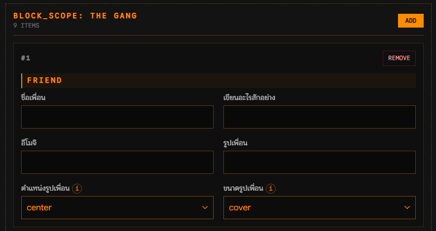

  

<h1 align="center">ZZZCODE EDITOR</h1>

Personalize your forum content. Preview it as you go.

A template editor built for the RoleplayTH and Hogthai communities. It turns structured templates into approachable forms, helping users personalize forum content, preview their changes, and copy ready-to-use HTML or BBCode.

[Visit the live project](https://zzzcode.vercel.app/)

## Project overview

Forum layouts can be difficult to customize without editing markup directly. ZZZCODE EDITOR gives users a form-based workflow while giving template creators control over the structure, styling, and editable content of their work.

The project brings template discovery, content editing, live previews, and draft management into one application, with separate browsing experiences for each community.

## Key experiences

- **Template discovery** — Search, category filters, and grid or list views help users find a suitable starting point.
- **Guided customization** — Text, colors, selections, and other configurable inputs make templates accessible through forms.
- **Flexible content** — Repeatable and nested sections support layouts with content that users can add, remove, duplicate, and reorder.
- **Live previews** — Community-specific rendering helps users review their work as they edit.
- **Draft continuity** — Autosave, undo and redo, multiple drafts, and optional online backups support ongoing work.
- **Creator tools** — Authorized creators can configure editable fields, defaults, categories, and template availability.
- **Controlled access** — Protected templates and permission-based tools support different publishing needs.

## Interface preview

*An example of the form-based editing experience, with repeatable sections and configurable content.*

## Design and engineering focus

The interface uses a terminal-inspired visual language with strong borders, compact navigation, and a consistent accent color. Responsive layouts accommodate both detailed editing on desktop and browsing on smaller screens.

Engineering work focuses on translating template structures into editable forms, keeping previews and exported output consistent, preserving draft state, and enforcing permissions on the server. Automated checks cover parsing, editor behavior, access control, and backup workflows.

## Technology

- Next.js, React, and TypeScript
- Tailwind CSS
- Supabase for application data, authentication, and storage
- Vercel for hosting

## About this repository

This repository presents the project as a portfolio work. Deployment instructions, environment configuration, and operational documentation are intentionally omitted.

Templates and their visual assets may have individual usage and attribution requirements. Please respect the terms and credits provided by their creators.
